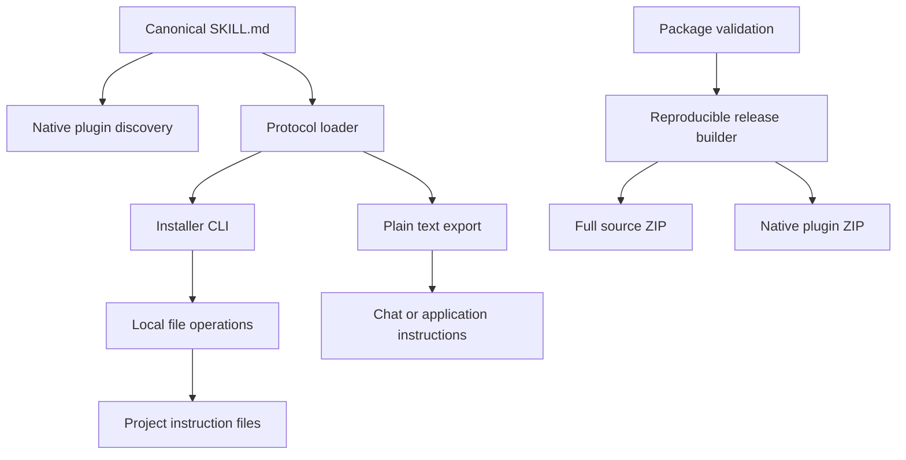

# Architecture

Precision Guard distributes behavioral instructions. Its executable code installs
those instructions and assembles releases; it does not sit between a model and
its tools, classify the truth of responses, or call an LLM.

## Components and boundaries

| Component | Responsibility | Side effects |
| --- | --- | --- |
| `plugins/precision-guard/skills/precision-guard/SKILL.md` | Canonical full policy and discovery metadata | None |
| `plugins/precision-guard/plugin.json` | Portable identity, version, description, license | None |
| `.claude-plugin/plugin.json` and `.codex-plugin/plugin.json` inside the plugin | Host compatibility metadata | None |
| Repository marketplace files | Locate the packaged plugin | Host installation is separate |
| `precision_guard/protocol.py` | Load the canonical policy and define block delimiters | Reads packaged text |
| `precision_guard/installer.py` | Transform byte content and safely replace a selected file | Explicit local writes and backups |
| `precision_guard/cli.py` | Parse arguments, choose targets, preflight, render output | Invokes local writes only outside dry-run |
| `precision_guard/distribution.py` | Check package invariants and build archives | Writes to the selected output directory |
| `install.py` and `manage.py` | Small command entry points | Delegate to the modules above |
| `CHAT.md` | Human-maintained shortened prompt | None |

There are no runtime third-party Python dependencies and no provider SDKs.
The native plugin does not require Python; Python is only for optional local
installation, validation, and release tooling. Model and client capabilities stay
with the host application.

## Single source of policy

The installer strips the skill's frontmatter and embeds its body directly into
the target file. Native clients load that same skill body. `--print` exports the
same text. There are no separately maintained Codex and Claude policy variants.

The short chat prompt is intentionally a summary, not generated output. Review
it whenever the full policy changes. Plugin metadata is repeated only where host
formats require it; the package validator checks that the name, description,
version, and license agree across those manifests.

The root `LICENSE` and `NOTICE` are canonical. Matching copies live in the plugin
directory because a marketplace may distribute that directory alone. Validation
rejects missing or divergent copies so both distribution paths carry the terms.

## Installer contract

1. Resolve explicit target filenames and reject symlinks in the target path.
2. Read and validate every target before starting writes. Refuse ambiguous
   markers, non-UTF-8 content, non-files, and an adjacent Codex override that would
   hide the selected `AGENTS.md`.
3. Compute new bytes by adding or replacing one managed block. Removal deletes
   only that block. Existing bytes outside it are preserved, including CRLF and
   missing final newlines.
4. With `--dry-run`, show the proposed textual diff and create no files or backups.
5. For each actual change, check that the original file still matches, create a
   uniquely named backup of existing content, write a temporary sibling file,
   preserve permission bits, and atomically replace that one target.

The newline separator belongs to the managed block, which permits byte-for-byte
restoration when the block is removed. The managed block itself uses LF endings.
Changing its delimiters manually makes the file ambiguous and requires manual
repair rather than a destructive guess. Repeated installation is idempotent.

This is per-file atomic replacement, not a multi-file transaction or a defense
against hostile concurrent processes. A late I/O failure can leave earlier files
updated. Backups are retained, including when a later replacement fails. Ownership,
ACLs, extended attributes, and hard-link identity are not preserved by contract;
use manual integration where those properties matter. New instruction files use
mode `0644` on POSIX; existing permission bits are retained. Backups are created
with the temporary-file API's private permissions.

## CLI contract

| Exit code | Meaning |
| --- | --- |
| `0` | Completed successfully, including an unchanged operation |
| `1` | Validation or filesystem error |
| `2` | Invalid command-line arguments |

`--target` and `--file` are alternatives. `--project` must name an existing
directory. `--file` may name a new file and creates missing parent directories
only when applying changes. `--print` is independent of installation options.
Uninstallation of persistent instructions does not uninstall native plugins.

## Distribution design

The full-source archive contains the installer, protocol, manifests, tests,
documentation, and CI configuration. The plugin archive contains the plugin's
own source files plus the GPL license and project notice. It has one top-level
directory suitable for extracting and passing to a host's plugin loader.

Release inputs come from explicit source directories and document names, not an
unfiltered workspace archive. Builds reject symlink inputs and omit bytecode,
backups, Git internals, and previous build output. This allowlist is not a secret
scanner: review the public content before release.

The ZIP writer fixes member ordering, timestamps, and mode bits, and stores bytes
without compression. Identical source bytes therefore produce identical archives
independent of source file timestamps. `SHA256SUMS` covers both archives; checksums
establish byte identity, not publisher identity or correctness.

The local validator checks this project's supported manifest shape, consistency,
paths, plain-scalar skill frontmatter, license presence, and relative document
links. It does not implement complete vendor schemas or claim native runtime
acceptance. Vendor validation and model behavior require separate checks.

## Extension rules

Add a new client adapter only when its documented instruction mechanism differs
from existing options. Reuse the canonical protocol. Include a narrow behavior
test for any new file operation. Keep optional integration-specific mechanics
outside the policy body.

An MCP service, a second model that critiques responses, lifecycle hooks, or a
tool-permission engine would introduce different runtime behavior, dependencies,
and failure modes. They require a concrete use case and a separate design; they
are not implicit features of this instruction plugin.
